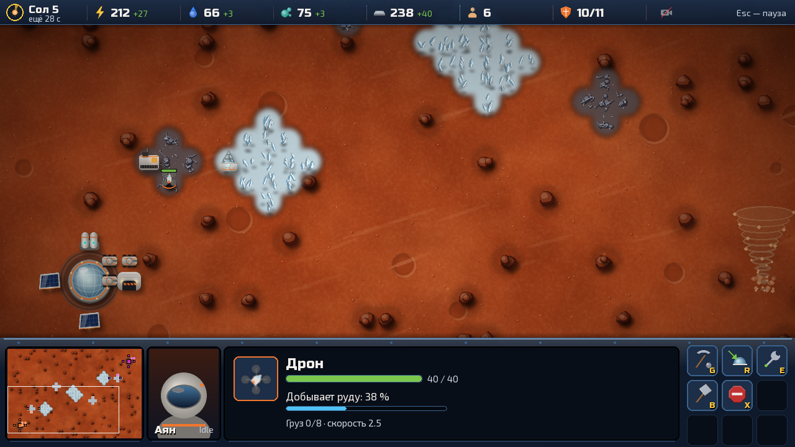

# Красный купол (Red Dome)

[](https://github.com/MMMirage20/red-dome/actions/workflows/tests.yml)
[](LICENSE)

RTS для ПК о первой колонии на Марсе. Игрок строит базу, добывает лёд и металл и воюет за кратер с ИИ-колонией «ВЕКТОР». Бортовой ИИ АРИЯ прогнозирует расход ресурсов, а армией можно командовать жестами и голосом.

Командный проект по дисциплине «Управление IT-проектами», тема №26 «AI-Колония на Марсе».

> **Статус (этап 3):** кампания из трёх миссий. «Высадка» — против «ВЕКТОРа» v0; «Война за лёд» — бой за три ледяных поля с ботом «Стратег», турелями, реактором, ракетными роверами и глобальной бурей; «Последний купол» — гонка за Большой купол против бота «Адаптивный», который ML-классификатором распознаёт стиль игрока и меняет стратегию, плюс метеориты и вспышки на Солнце. Миссии 2–3 открывает демо-покупка «Полной экспедиции» в магазине (профиль игрока в SQLite). Жестами с веб-камеры (или клавишами F1–F8, F10, F11) можно командовать армией и дронами, а также пройти меню, выбор миссии, магазин, паузу и итоги без мыши. Все три миссии облегчены для новичка (S3-12): позже и меньше волн, предел армии ВЕКТОРа, мягче метеориты и вспышки — замеры «до/после» в [docs/balance/missions.md](docs/balance/missions.md). Графика процедурная, интерфейс в духе Warcraft III. 204 теста. Что осталось — в разделе «Где продолжать».



Остальные снимки — в [docs/screenshots](docs/screenshots): загрузка, меню, выбор миссии, старт, меню стройки, ночь, бой, пауза, итоги с очками. Их делает `python -m tools.screenshot` без окна.

## Этапы и версии

Работа идёт этапами. В конце каждого этапа на `main` ставится тег, задачи этапа — Issues с меткой `stage-N` (подробнее — в [CONTRIBUTING.md](CONTRIBUTING.md)).

| Этап | Тег | Что работает |
| --- | --- | --- |
| 1. MVP 1 (неделя 3, ЛР11), публикация на GitHub | `v0.1-mvp1` | Миссия 1, 6 зданий, дрон и охранный ровер, бот «ВЕКТОР» v0 по скрипту, 8 команд жестами двух рук, экран итогов, магазин-заглушка; CI, лицензия, скачивание моделей |
| 2 | `v0.2-easy` | Миссия 1 легче для новичка: волны ВЕКТОРа позже, реже и меньше (2, 2, 3, 3…), фора игрока — 200 металла и купол на 2000 HP; уровни сложности «Лёгкий / Обычный / Сложный»; отчёт баланса `sim_cli --report` |
| 3 | `v0.3-missions` | Миссии 2–3 ([ТЗ этапа 3](docs/tz-stage3-missions.md)): турель, реактор, ракетный ровер, Большой купол; ледяные поля, буря, метеориты, вспышки; боты «Стратег» и «Адаптивный» с классификатором стиля; профиль SQLite, демо-покупка, «Следующая миссия»; миссии 1–3 легче — правки баланса по миссиям (S3-12) |
| 4 | `v0.4-voice` | TODO: состав этапа — по ТЗ этапа 4 |
| 5 | `v0.5-gestures` | TODO: состав этапа — по ТЗ этапа 5 |
| 6 | `v0.6-heroes` | TODO: состав этапа — по ТЗ этапа 6 |

Прежний план по неделям (MVP 2 — ML-прогноз и бот v1, Beta — 3 миссии и сложность бота, Release — сборка `.exe`) заменён этапами 2–6; исходные вехи — в [уставе проекта](docs/charter.md).

## Технологии

Вся игра написана на Python, отдельного сервера нет.

| Часть | Технологии |
| --- | --- |
| Игра и интерфейс | Python 3.13, pygame-ce; кнопки — свои виджеты в `reddome/ui/widgets.py` |
| Поиск пути | Своя реализация A* в `reddome/sim/pathfinding.py`: детерминированная, поэтому партия повторяется по seed |
| Жесты | mediapipe (Gesture Recognizer) + OpenCV для камеры, в отдельном потоке |
| Голос | vosk с малой русской моделью, офлайн; микрофон через sounddevice |
| ML | scikit-learn или LightGBM, pandas; модель сохраняется в файл и грузится игрой |
| Данные | SQLite из стандартной библиотеки: профиль, сохранения, рекорды, покупки |
| Тесты | pytest |
| Сборка | PyInstaller → `.exe` для демо и публикации на itch.io |

## Структура репозитория

```
red-dome/
├── reddome/                     пакет игры
│   ├── __main__.py              запуск: python -m reddome
│   ├── app.py                   главный цикл и стек сцен
│   ├── config/
│   │   ├── balance.json         все числа баланса
│   │   ├── balance.py           загрузка и проверка баланса
│   │   └── graphics.py          настройки графики: частицы, тени, день и ночь
│   ├── profile.py               профиль игрока в SQLite: покупки, результаты миссий, воронка магазина
│   ├── scenes/                  boot, menu, missions (выбор миссии), game, pause, result, shop (демо-покупка)
│   ├── sim/                     симулятор без графики (pygame не импортирует)
│   │   ├── types.py             состояние игры
│   │   ├── map.py               карта 48 × 32, зеркальная; 4 рудных поля (по 2 на сторону)
│   │   ├── pathfinding.py       A* в 8 направлениях без срезания углов
│   │   ├── economy.py           сол: энергия, вода, кислород, металл, лимит армии
│   │   ├── workers.py           дроны: добыча, сдача груза, стройка, ремонт
│   │   ├── build.py             стройплощадки, прогресс стройки, отмена
│   │   ├── production.py        очередь сборки, точка сбора
│   │   ├── combat.py            автозахват цели, атака, атака с движением, разрушение
│   │   ├── units.py             приказ на движение и движение
│   │   ├── dust.py              пылевой вихрь: маршрут по seed, пыль на солнечных панелях
│   │   ├── hazards.py           глобальная буря, метеориты, вспышки на Солнце (этап 3)
│   │   ├── objectives.py        цели миссий: ледяные поля, Большой купол (этап 3)
│   │   ├── score.py             очки миссии по balance.score
│   │   ├── rules.py             победа и поражение
│   │   └── simulation.py        фасад: шаг 100 мс, контроллеры (бот) и команды
│   ├── bot/                     «ВЕКТОР»: v0 «Новичок», «Стратег», «Адаптивный», классификатор стиля и его модель (style_model.json)
│   ├── render/                  процедурная графика: спрайты, карта, свет, частицы, мир
│   ├── input/                   жесты: маппер, камера (mediapipe + OpenCV), эмуляция F1–F8, F10, F11, сервис и лог
│   └── ui/                      палитра и шрифты, иконки, кнопки, HUD, нижняя панель, курсоры
├── assets/
│   ├── fonts/                   Russo One и Exo 2 (SIL OFL 1.1)
│   └── sprites/                 сюда можно положить PNG — они заменят процедурные спрайты
├── models/                      модели жестов и голоса (качает tools/download_models.py, в git не попадают)
├── tools/
│   ├── download_models.py       скачивание и проверка моделей (SHA-256), только стандартная библиотека
│   ├── sim_cli.py               партии «бот против бота» без графики → CSV для ML; отчёт баланса по миссии
│   ├── balance_matrix.py        матрица баланса: 3 миссии × сложность × 3 «заменителя» игрока
│   ├── ui_playtest.py           прогон миссии через интерфейс без окна: мышь и клавиши, лог и снимки
│   ├── build_windows.py         сборка RedDome.exe и zip для itch.io (PyInstaller); reddome_launcher.py — точка входа
│   ├── style_bots.py            скрипты игрока с заданным стилем (раш, черепаха, экономист, техно)
│   ├── train_style.py           обучение классификатора стиля → reddome/bot/style_model.json и docs/ml
│   ├── gesture_bench.py         замер точности жестов с камеры → CSV
│   ├── screenshot.py            скриншоты без окна → docs/screenshots
│   └── bench_fps.py             замер FPS с 60 юнитами
├── tests/                       тесты pytest
├── ml/data/                     сюда пишет sim_cli, в git не попадает
├── docs/                        устав проекта (charter.md), ТЗ и другие документы
├── .github/                     CI (workflows/tests.yml), шаблоны Issue и pull request
├── requirements.txt             игра и тесты
├── requirements-ai.txt          жесты, голос, ML (нужно с недели 3)
├── pyproject.toml               настройки pytest
├── CONTRIBUTING.md              как мы работаем: ветки, PR, теги этапов
└── LICENSE                      MIT для кода (шрифты — SIL OFL 1.1)
```

Симулятор (`reddome/sim`) и бот (`reddome/bot`) не зависят от pygame. Один и тот же код работает в игре, в тестах и в генераторе датасета.

## Быстрый старт

Нужен Python 3.13 (каркас проверен на 3.13.7 под Windows). На этой версии ставятся все пакеты, включая mediapipe.

**1. Установка.** Склонировать репозиторий и создать окружение:

```bash
git clone https://github.com/MMMirage20/red-dome.git
cd red-dome
```

Windows:

```bash
py -3.13 -m venv .venv
.venv\Scripts\activate
```

Linux и macOS:

```bash
python3.13 -m venv .venv
source .venv/bin/activate
```

Зависимости игры и тестов:

```bash
pip install -r requirements.txt
```

Для жестов и голоса — ещё и `requirements-ai.txt`. Игра запускается и без него. OpenCV ставится как `opencv-contrib-python` — его требует сам mediapipe; `opencv-python` рядом с ним ставить нельзя, оба кладут модуль `cv2`:

```bash
pip install -r requirements-ai.txt
```

**2. Скачивание моделей.** Модели не хранятся в git. Скрипт качает их в `models/`, сверяет SHA-256 и пропускает то, что уже скачано и проверено:

```bash
python tools/download_models.py
```

Только одну модель: `--gestures` (MediaPipe Gesture Recognizer → `models/gesture_recognizer.task`) или `--voice` (малая русская модель Vosk → `models/vosk/vosk-model-small-ru-0.22/`). `--force` качает заново.

**3. Запуск игры:**

```bash
python -m reddome
```

«Играть» открывает выбор миссии. Миссия 1 «Высадка» открыта; миссии 2–3 под замком — щелчок по ним ведёт в магазин, где «Купить (демо)» открывает их (деньги не списываются, покупка сохраняется в профиле). Сложность общая для всех миссий — кнопка под карточками или стрелки ← → (Лёгкий / Обычный / Сложный), Enter — начать. Текущая сложность видна на паузе и на экране итогов, после победы там же есть «Следующая миссия».

Профиль (покупки, лучший счёт, воронка магазина) лежит в `%APPDATA%\RedDome\profile.sqlite3` (Linux и macOS — `~/.reddome/profile.sqlite3`); другой файл — `--profile путь`, например чистый профиль для демо.

**4. Запуск тестов:**

```bash
pytest
```

Тесты, которым нужны mediapipe, OpenCV, Vosk или файлы моделей, без них пропускаются (skip). CI на GitHub ставит только `requirements.txt` и запускает тот же `pytest` (`.github/workflows/tests.yml`).

### Флаги запуска

| Флаг | Что делает |
| --- | --- |
| `--debug` | FPS в углу и отладочные клавиши: **K** — разрушить купол ВЕКТОРа (победа), **L** — свой купол (поражение) |
| `--seed N` | Другая карта (по умолчанию 1) |
| `--low` | Пресет для слабого ноутбука: без частиц, теней и смены дня и ночи |
| `--no-particles`, `--no-shadows`, `--no-daynight` | Выключить один эффект |
| `--camera N` | Номер камеры для жестов (по умолчанию 0) |
| `--no-gestures` | Не включать камеру и жесты |
| `--gesture-keys` | Эмуляция жестов клавишами F1–F8, F10, F11 (включена и в `--debug`) — если камера не работает |
| `--swap-hands` | Поменять левую и правую руку, если камера их путает |
| `--profile ФАЙЛ` | Файл профиля SQLite (покупки и результаты) |

### Другие команды

Датасет «бот против бота» (200 партий, около 10 с на партию):

```bash
python -m tools.sim_cli --games 200 --seed 1 --out ml/data/games_v0.csv
```

Строка — одна сторона в один сол: ресурсы, колонисты, лимит армии, добытый металл, число зданий и юнитов по типам, зелёные солы, числа бота этой стороны и победитель партии. Числа ботов слегка случайны от seed партии (`--jitter 0.15`: ±15 % к таймингам волн, ±1 дрон; `--jitter 0` — без разброса), поэтому один и тот же запуск даёт один и тот же файл.

Отчёт баланса: итог партий, время и размер волн, минимальное HP купола, металл к 180 с, роверы к первой волне, ангар, истощение полей. `--difficulty easy|normal|hard` — уровень сложности, `--md` — таблицы Markdown (так сделаны [docs/balance](docs/balance)):

```bash
python -m tools.sim_cli --games 20 --seed 1 --report --difficulty normal
python -m tools.sim_cli --games 12 --seed 1 --report --difficulty normal --mission 2
```

`--mission 2` и `--mission 3` ставят бота миссии («Стратег», «Адаптивный»), её цель и правки баланса; за игрока тогда играет «Стратег».

Матрица баланса кампании — сколько партий из N выигрывают, сводят вничью и проигрывают три «заменителя» игрока: без армии, осторожный (армия только в обороне) и активный. Партии идут параллельно, около 3 минут на 12 партий в клетке:

```bash
python -m tools.balance_matrix --games 12 --difficulty easy normal hard
```

Сборка для Windows (itch.io): папка `dist/RedDome` с `RedDome.exe` и архив `dist/RedDome-windows.zip`. Нужны `requirements-ai.txt` и `pyinstaller`; модель жестов в архив не входит — игра скачивает её с сервера Google при первом запуске в `%APPDATA%\RedDome\models`. Проверка собранной игры без окна: `dist\RedDome\RedDome.exe --selftest отчёт.txt`.

```bash
python -m tools.build_windows
```

Прогон миссии через интерфейс без окна: «игрок» проходит меню, магазин, партию и итоги только мышью и клавишами, как человек; лог с подсказками игры и снимки экрана — в `playtest_out/` (в git не попадает). Около 2 минут на партию:

```bash
python -m tools.ui_playtest --mission 2 --seed 1 --difficulty normal
```

Классификатор стиля игрока для бота «Адаптивный» (нужен `requirements-ai.txt`; около минуты на 240 партий). Сохраняет модель в `reddome/bot/style_model.json` и отчёт с матрицей ошибок в [docs/ml/style_classifier.md](docs/ml/style_classifier.md):

```bash
python -m tools.train_style --games 60 --seed 1
```

Скриншоты без окна и замер FPS:

```bash
python -m tools.screenshot
```

```bash
python -m tools.bench_fps --units 60
```

Без mediapipe, без модели или без камеры игра запускается и работает с мыши и клавиатуры; в начале партии появится подсказка «Камера недоступна — жесты выключены», а в верхней панели — серая перечёркнутая иконка камеры. Причина видна в оверлее **F9**.

Замер точности жестов (окно с заданиями, 20 попыток на жест, кадры камеры не сохраняются):

```bash
python -m tools.gesture_bench --trials 20
```

В VS Code выберите интерпретатор `.venv` (Ctrl+Shift+P → «Python: Select Interpreter»), тогда тесты появятся во вкладке Testing.

## Управление

Камера занята клавишами WASD, поэтому команды висят на других буквах. Горячая клавиша подписана в углу каждой кнопки сетки команд, а подсказка при наведении показывает цену и что даёт здание.

| Действие | Мышь и клавиатура | Жест | Голос (с этапа 4 `v0.4-voice`, удерживать V) |
| --- | --- | --- | --- |
| Выделить | Клик; рамка; Shift — добавить; двойной клик — все такие же на экране | — | «Выбрать всех» |
| Выбрать дрона | `.` или кнопка с дроном над мини-картой — свободный дрон | Ладонь **левой**: свободный дрон, если свободных нет — следующий по кругу; камера к нему | — |
| Выбрать всех роверов | Рамка | Ладонь **правой** | — |
| Группы | Ctrl+цифра — назначить, цифра — выбрать, дважды — камера к группе | — | — |
| Приказ по цели | ПКМ: по руде — добывать, по врагу — атаковать, по своей площадке — строить, по повреждённому зданию — чинить, по земле — идти | — | «Все в атаку» |
| Атака на базу ВЕКТОРа | F, затем щелчок у купола ВЕКТОРа | Указательный вверх, любой рукой, держать дольше: выделенные роверы (или все) атакой с движением идут к куполу ВЕКТОРа | — |
| За работу | G, затем щелчок по полю | Большой палец вверх, любой рукой: выделенные или все свободные дроны — на ближайшее поле | — |
| Отступить к куполу | R | Большой палец вниз, любой рукой: выделенные (или все роверы) | «Отступить» |
| Собрать дрона / ровера | Купол или ангар → Q | V **левой** — дрон, V **правой** — ровер | — |
| Собрать ракетного ровера (с миссии 2) | Ангар → Z | Кулак **правой**, держать дольше (нужен готовый реактор) | — |
| Дроны на стройку | ПКМ дронами по своей площадке | Кулак **левой**, держать дольше: выделенные или все свободные дроны — на Большой купол, иначе на площадку с наименьшим числом строителей | — |
| Точка сбора | Выделить купол или ангар, ПКМ по земле (или T); точка на руде — новые дроны сразу добывают | — | — |
| Камера | WASD, стрелки, мышь у края окна, клик по мини-карте | — | — |
| Пауза / продолжить | Esc (в режиме прицела и стройки Esc и ПКМ сначала отменяют режим) | ILY (большой, указательный и мизинец) любой рукой, 1 с | «Пауза» |
| Меню, миссии, магазин, пауза, итоги | Мышь, Enter, Esc | Ладонь **правой** — следующая кнопка, **левой** — предыдущая; большой палец вверх (или указательный) — нажать; большой палец вниз — назад; ILY в паузе — продолжить | — |
| Оверлей жестов | F9: превью камеры, жест, рука, уверенность, частота распознавания, статус | — | — |

Жесты: левая рука — экономика и дроны, правая — армия и роверы. Жест срабатывает при уверенности ≥ 0,7 после удержания: 0,5 с, атака — 0,8 с, пауза — 1 с; после любой команды 0,6 с ничего не срабатывает. Кулаки держат так же долго, как атаку (0,8 с): кулак — частая «нерабочая» поза руки. Все пороги — в `balance.json` → `gestures`. В меню выбранная жестом кнопка подсвечивается, а внизу экрана видна подсказка по жестам. Удержание видно над портретом Аяна: иконка жеста, рука (Л/П), кольцо прогресса и будущая команда; при срабатывании Аян переходит в Action. Рука — это рука игрока: кадр для распознавания не зеркалится, как требует документация mediapipe; если на вашей камере руки перепутаны, запустите с `--swap-hands`.

Эмуляция клавишами (`--gesture-keys` или `--debug`), держать как жест: **F1** — ладонь левой, **F2** — ладонь правой, **F3** — указательный вверх, **F4** — большой вверх, **F5** — большой вниз, **F6** — V левой, **F7** — V правой, **F8** — ILY, **F10** — кулак левой, **F11** — кулак правой. Памятка по жестам — в паузе на вкладке «Жесты» (Tab).

Каждая смена распознанного жеста и каждая сработавшая команда пишутся в `ml/data/gesture_log_ГГГГММДД.csv` (время от запуска в мс, жест, рука, уверенность, команда, источник `camera`/`keys`) — только названия и числа, кадры с камеры на диск не попадают.

Команды дрона и ровера:

| Клавиша | Команда |
| --- | --- |
| G | Добывать (дальше щелчок по рудному полю) |
| R | Вернуть груз на базу; у роверов — отступить к куполу |
| E | Чинить своё здание за металл |
| B | Меню стройки: **P** — солнечная панель, **I** — ледяной бур (только на лёд), **O** — генератор кислорода, **E** — переработчик (только на рудный выход), **H** — ангар; с миссии 2 — **T** турель, **R** реактор; в миссии 3 — **G** Большой купол. Esc — назад |
| X | Стоп; у здания — отменить стройку или последний юнит в очереди |
| F | Атака (роверы): щелчок по врагу — атака цели, по земле — атака с движением |
| Q | У купола — собрать дрона, у ангара — охранного ровера (очередь до 5) |
| Z | У ангара — ракетный ровер (с миссии 2, нужен готовый реактор) |
| T | Точка сбора купола или ангара |

При стройке под курсором виден призрак здания: зелёный — можно ставить, красный — нельзя (причина подписана над клеткой). Подходящие клетки подсвечиваются. Shift+клик ставит несколько зданий подряд. Строит ближайший из выделенных дронов, а если дроны не выделены — ближайший свободный.

Без камеры игра полностью работает с мыши и клавиатуры.

## Как устроена экономика

Металл приносят дроны, как рабочие в Warcraft III. Дрон добывает 4 с, берёт 8 металла, несёт к ближайшему куполу или переработчику и возвращается к своему полю. Запитанный переработчик даёт +25 % к сданному грузу. На поле одновременно добывают не больше 3 дронов, остальные ждут. Поле на 3000 металла кончается и превращается в грунт — тогда дроны идут к ближайшему другому. Здание строят дроны: площадка появляется сразу, а прогресс растёт, пока рядом работают строители (до 3, каждый ускоряет). Все числа — в `balance.json`, разделы `workers`, `deposit`, `construction`, `production`.

## Миссии

| Миссия | ВЕКТОР | Цель | Новое |
| --- | --- | --- | --- |
| 1. «Высадка» (бесплатно) | v0 «Новичок»: первая волна на 5,5-й минуте, волны по 1, 1, 2, 2… ровера, у базы не больше 8 роверов | Разрушить командный купол ВЕКТОРа (1200 HP) | Пылевой вихрь; у вас 250 металла и купол на 2500 HP |
| 2. «Война за лёд» | «Стратег»: с 6-й минуты занимает центральное ледяное поле, ставит у бура турель, волны бьют по вашим бурам; не больше 8 роверов | Удержать 2 из 3 ледяных полей 5 солов подряд — ВЕКТОРу для победы нужно 10 (поле ваше, если на нём ваш готовый бур, а бура ВЕКТОРа нет) | Турель, реактор, ракетный ровер; глобальная буря; руды на полях 2500 |
| 3. «Последний купол» | «Адаптивный»: с 3-й минуты раз в сол угадывает ваш стиль и включает контрстратегию; с 18-й минуты строит Большой купол; не больше 10 роверов | Разрушить купол ВЕКТОРа (1200 HP) или первым достроить Большой купол | Большой купол; метеориты (метка за 6 с, урон 35 — дрон переживает одно попадание), вспышки на Солнце (роверы дальше 6 клеток от купола теряют 3 HP/с) |

Числа — для уровня «Обычный»; «Лёгкий» и «Сложный» умножают их так же, как в миссии 1 (раздел «Настройка баланса»).

Карточка цели слева под верхней панелью показывает прогресс (поля, удержание, Большой купол), баннер по центру — обратный отсчёт до бури и вспышки. Все числа — в `balance.json`: разделы `missions`, `storm`, `meteors`, `solar_flare`, новые здания и юниты, тайминги ботов в `bot`.

**Стиль игрока.** «Адаптивный» относит игрока к одному из стилей устава — «Раш», «Черепаха», «Экономист», «Техно» — по признакам, которые видит на карте (число роверов, турелей, буров, когда появились ангар и реактор, когда армия подошла к базе). Модель — логистическая регрессия, обученная на партиях «скрипт со стилем против бота»; в игре она читается из JSON без scikit-learn, а без файла бот берёт правила из таблицы устава. В `--debug` внизу экрана видно, каким ВЕКТОР считает ваш стиль.

## Где продолжать

Закрыто на неделе 3: W3-01 … W3-13 и W3-15 (подробности — в [ТЗ](docs/tz-week3-mvp1.md)). Закрыто на этапе 3: S3-01 … S3-08 ([ТЗ этапа 3](docs/tz-stage3-missions.md)).

| Задача | Файлы | Что осталось |
| --- | --- | --- |
| W3-14 | — | Прогон сценария демо на ноутбуке команды, тег `v0.1-mvp1` (ставит `_publish/publish_stage2.ps1`) |
| S3-09 | `docs/balance`, `docs/screenshots` | Отчёт по миссиям и автоматический прогон через интерфейс сделаны ([docs/balance/missions.md](docs/balance/missions.md)); осталось — прогон живыми игроками и тег `v0.3-missions` |
| Классификатор стиля | `tools/style_bots.py`, `tools/train_style.py` | Точность 1,00 получена на скриптах — перемерить на партиях живых тестеров (устав, раздел 4) |
| Жесты, неделя 4 | `tools/gesture_bench.py` | Замер точности на живой камере (цель ЛР8 — 85 %), теперь 10 команд вместе с кулаками |
| Пылевой вихрь, дальше | `sim/dust.py` | По уставу панели можно «сложить» жестом перед вихрем — пока панели только засыпаются |
| Документы | `docs/` | Требования и MoSCoW (ЛР9), WBS, риски и архитектура (ЛР10) |

## Настройка баланса

Все числа игры лежат в `reddome/config/balance.json`: длительность сола, стоимость и выработка зданий, параметры юнитов, расписание атак бота, пороги жестов, формула очков. После правки достаточно перезапустить игру. Если ключ написан с ошибкой, игра сразу сообщит, в каком разделе.

Пример — первая волна ВЕКТОРа придёт через минуту, а волны будут расти на одного ровера каждую вторую волну (2, 2, 3, 3, 4…):

```json
"bot": { "first_wave_sec": 60, "wave_interval_sec": 200, "wave_size_start": 2, "wave_growth": 1, "wave_growth_every": 2 }
```

В волну уходит ровно столько роверов, сколько даёт формула; остальные остаются у базы ВЕКТОРа охраной.

**Фора игрока.** Раздел `player` — то, что у игрока лучше, чем у ВЕКТОРа: стартовый металл (`start_metal`) и полное HP купола (`dome_hp`). Остальные разделы общие для обеих сторон.

**Уровни сложности.** Раздел `difficulty` — множители для каждого уровня; у «Обычного» все 1.0, то есть это числа из остальных разделов:

| Множитель | Что меняет | Лёгкий | Обычный | Сложный |
| --- | --- | --- | --- | --- |
| `bot_timing` | время до первой волны ВЕКТОРа и интервал между волнами | 1.25 | 1.0 | 0.8 |
| `bot_waves` | размер волн ВЕКТОРа (округление половины вверх, не меньше 1) | 0.75 | 1.0 | 1.25 |
| `bot_resources` | стартовые ресурсы ВЕКТОРа и металл, который сдают его дроны | 0.8 | 1.0 | 1.2 |
| `player_dome_hp` | полное HP купола игрока | 1.25 | 1.0 | 0.9 |

**Очки.** Раздел `score` — веса формулы из ГКД: `win` за победу, `killed_unit` за каждого уничтоженного юнита ВЕКТОРа, `population` за каждого живого колониста к концу партии (купол разрушен — колонисты считаются погибшими), `green_sol` за каждый сол в зелёной зоне (энергии, воды и кислорода хватит больше чем на 3 сола при расходе этого сола), `lost_colonist` за каждого погибшего. Итог и расшифровка — на экране итогов.

**Правки миссий.** У миссии в `missions.N.overrides` — свои числа поверх общих разделов, теми же ключами, что в `player`, `bot`, `buildings`, `meteors` и других. Так облегчена кампания (S3-12), например миссия 1:

```json
"overrides": {
  "player": { "start_metal": 250, "dome_hp": 2500 },
  "buildings": { "dome": { "hp": 1200 } },
  "bot": { "target_drones": 4, "first_wave_sec": 330, "wave_interval_sec": 240, "wave_size_start": 1, "wave_growth_every": 2, "max_fighters": 8 }
}
```

`buildings.dome.hp` — купол ВЕКТОРа (купол игрока задаёт `player.dome_hp`). Множители сложности применяются поверх правок миссии. Новый ключ в правках не появится: опечатку игра покажет при загрузке. Разделы `missions` и `difficulty` миссия не переопределяет. Числа бота этапа S3-12: `max_fighters` — сколько бойцов ВЕКТОР держит самое большее (0 — без предела; бот за игрока в отчётах им не ограничен), `economy_raid_sec` — как часто «Адаптивный» набегает на «экономиста», `tech_attack_size` и `tech_window_sec` — с какого числа роверов и сколько секунд после появления вашего реактора он атакует «техно». В миссии 2 `hold_sols` — сколько солов подряд держать поля вам, `vector_hold_sols` — ВЕКТОРу. Код читает готовые числа партии через `balance.for_mission(N)` — так делает `Simulation`.

**Пылевой вихрь.** Раздел `dust_devil`: первый вихрь появляется через `first_sec`, живёт `lifetime_sec` и рассеивается, следующий — через `interval_sec`. Идёт со скоростью `speed` клеток в секунду по маршруту, который зависит от seed. Солнечная панель любой стороны ближе `radius` клеток засыпается на `dust_sec` и выдаёт в сол на `solar_penalty` меньше энергии.

Множители применяются в одном месте — при загрузке баланса (`side_specs` в `reddome/config/balance.py`); код игры читает готовые числа через `balance.side(сторона)` и `balance.max_hp(сторона, здание)`. Сложность — параметр партии рядом с seed: `Simulation(balance, seed, "easy")`. Как подбирались числа — в [docs/balance](docs/balance).

## Как мы работаем

Подробно — в [CONTRIBUTING.md](CONTRIBUTING.md).

- Задачи заведены как Issues с ID из ТЗ (например, `W3-08`) и меткой этапа `stage-2` … `stage-6`; ведутся на доске GitHub Projects: Todo → In progress → Review → Done.
- Каждая задача делается в своей ветке `feature/<ID>-<кратко>`, например `feature/W3-08-economy`; в `main` попадает только через pull request с ревью второго участника и зелёным CI.
- Сообщение коммита начинается с ID задачи: `W3-08: очередь сборки юнитов`.
- `main` всегда запускается и проходит `pytest`; в конце этапа ставится тег: `v0.1-mvp1`, `v0.2-easy`, `v0.3-missions`, `v0.4-voice`, `v0.5-gestures`, `v0.6-heroes`.

## Документация

| Документ | Где |
| --- | --- |
| Project Charter и Game Concept Document (ЛР8) | [docs/charter.md](docs/charter.md) |
| ТЗ на неделю 3 — MVP 1 (ЛР11) | [docs/tz-week3-mvp1.md](docs/tz-week3-mvp1.md) |
| ТЗ этапа 3 — миссии 2–3 | [docs/tz-stage3-missions.md](docs/tz-stage3-missions.md) |
| Классификатор стиля игрока: данные, accuracy, матрица ошибок | [docs/ml/style_classifier.md](docs/ml/style_classifier.md) |
| Требования, User Stories, MoSCoW (ЛР9) | `docs/` — добавить |
| WBS, риски, архитектура (ЛР10) | `docs/` — добавить |

## Сторонние ресурсы и лицензии

Каждую библиотеку, шрифт, звук и изображение не нашего авторства записываем сюда до того, как добавить в игру. Спрайты, иконки, карта и фоны рисуются кодом (`reddome/render`, `reddome/ui/icons.py`), сторонних картинок в игре нет. Иконки жестов тоже нарисованы кодом — эмодзи в шрифтах Russo One и Exo 2 нет.

| Ресурс | Где используется | Лицензия | Источник |
| --- | --- | --- | --- |
| pygame-ce 2.5.8 | Игра | LGPL v2.1 (по метаданным пакета) | https://pyga.me |
| Шрифт Russo One, © 2011–2012 Jovanny Lemonad | Заголовки и числа (`assets/fonts/RussoOne-Regular.ttf`) | SIL OFL 1.1, зарезервированное имя «Russo»; текст лицензии — `assets/fonts/OFL-RussoOne.txt` | https://github.com/google/fonts/tree/main/ofl/russoone |
| Шрифт Exo 2, © 2013 The Exo 2 Project Authors | Текст интерфейса (`assets/fonts/Exo2-Variable.ttf`) | SIL OFL 1.1; текст лицензии — `assets/fonts/OFL-Exo2.txt` | https://github.com/google/fonts/tree/main/ofl/exo2 |
| mediapipe 1.2.0 | Жесты | Apache 2.0 (по метаданным пакета) | https://github.com/google/mediapipe |
| Модель `gesture_recognizer.task` (HandGestureClassifier, float16) | Жесты, `models/` (качает `tools/download_models.py`, в git не хранится) | Отдельной лицензии на модель нет ни на странице Gesture Recognizer, ни в её карточке (model card). Страница: текст — CC BY 4.0, примеры кода — Apache 2.0. Карточка: назначение — исследования и развлечения, слежка и распознавание личности — вне области применения | Страница: https://developers.google.com/edge/mediapipe/solutions/vision/gesture_recognizer; карточка: https://storage.googleapis.com/mediapipe-assets/gesture_recognizer/model_card_hand_gesture_classification_with_faireness_2022.pdf |
| OpenCV (`opencv-contrib-python` 5.0.0.93) | Камера | Apache 2.0 (по метаданным пакета) | https://github.com/opencv/opencv-python |
| vosk (библиотека vosk-api), ≥ 0.3.45 | Голос (с этапа 4) | Apache 2.0 (файл `COPYING` в репозитории) | https://github.com/alphacep/vosk-api |
| Модель `vosk-model-small-ru-0.22` (45 МБ) | Голос, `models/vosk/` (качает `tools/download_models.py`, в git не хранится) | Apache 2.0 — указано в столбце License таблицы моделей на официальном сайте | https://alphacephei.com/vosk/models |
| scikit-learn 1.9.1 | ML: обучение классификатора стиля (`tools/train_style.py`); игре не нужен | BSD-3-Clause (по метаданным пакета) | https://scikit-learn.org |

**Лицензия проекта.** Код распространяется под MIT — см. [LICENSE](LICENSE). Шрифты под MIT не попадают: Russo One и Exo 2 остаются под SIL Open Font License 1.1, полные тексты лицензий лежат рядом со шрифтами — [assets/fonts/OFL-RussoOne.txt](assets/fonts/OFL-RussoOne.txt) и [assets/fonts/OFL-Exo2.txt](assets/fonts/OFL-Exo2.txt). Модели жестов и голоса в репозиторий не входят и распространяются их авторами на условиях из таблицы выше.

## Команда

| Роль | Участник | Зона ответственности |
| --- | --- | --- |
| Technical Lead / AI & Backend Lead | TODO: ФИО | Архитектура, симулятор, бот «ВЕКТОР», ML-прогноз и классификатор, жесты и голос, хранение данных, тесты AI |
| Project Manager / Game & Frontend Lead | TODO: ФИО | План и доска задач, требования, UI/UX, персонажи и графика, сцены, интерфейс, игровая механика |
